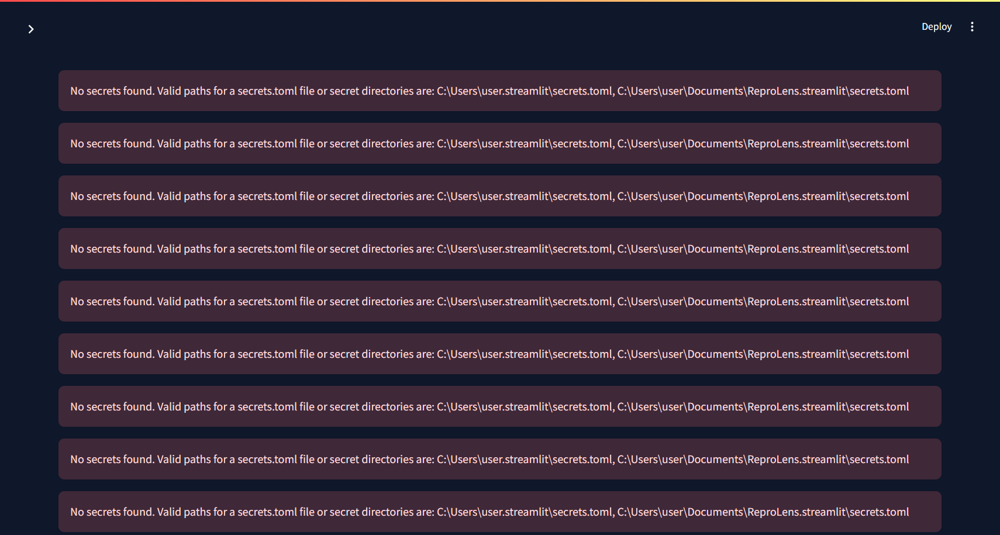
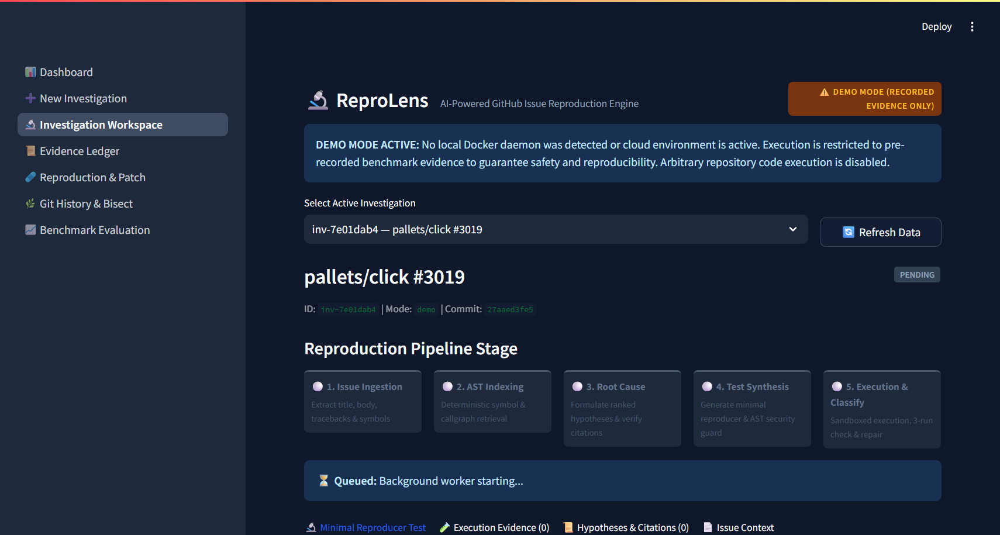
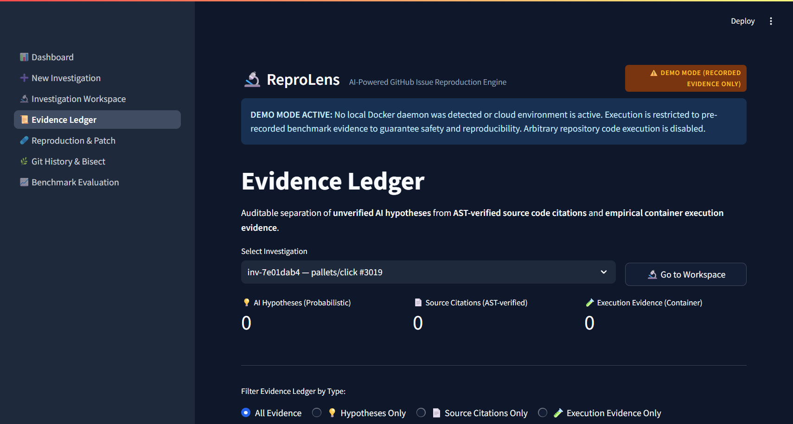
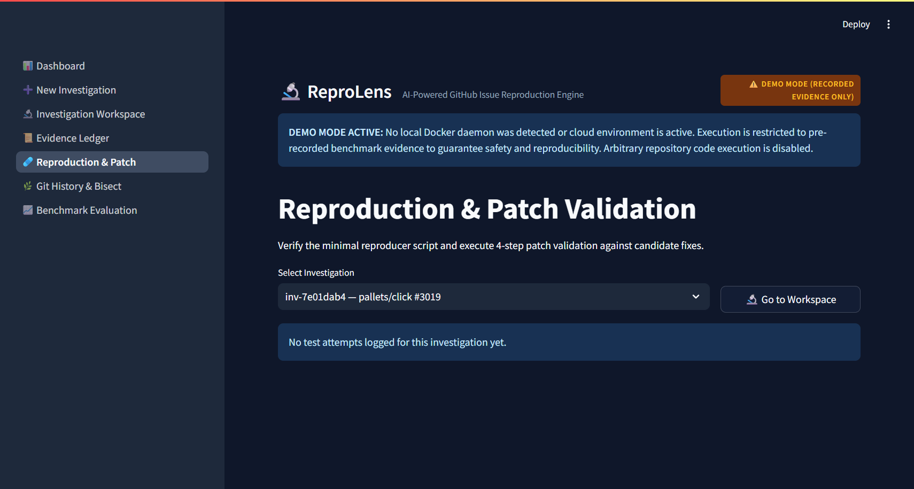

# ReproLens: AI-Powered GitHub Issue Reproduction Engine

> *"Don't trust the diagnosis. Trust the failing test."*

[](https://www.python.org/downloads/release/python-3120/)
[](docs/TEST_REPORT.md)
[](https://github.com/astral-sh/ruff)
[](https://streamlit.io/)
[](LICENSE)

**ReproLens** transforms ambiguous, conversational GitHub bug reports into deterministic, minimal, sandboxed `pytest` reproductions that fail for the exact reported symptom—or clearly issues an **honest refusal (`NOT_REPRODUCED`)** if the bug does not exist on the target revision.

---

## 📸 User Interface Showcase

| Dashboard & Metrics | Minimal Reproducer & Stage Progress |
| :---: | :---: |
|  |  |

| Evidence Ledger | 4-Gate Patch Validation |
| :---: | :---: |
|  |  |

---

## 🎯 Key Differentiators

1. **Reproduction-First Triage**: While traditional coding assistants guess a code edit and hope it works, ReproLens proves the bug first by generating a self-contained, minimal reproduction script verified inside a hardened container.
2. **Auditable Evidence Ledger**: Strict mathematical separation between:
   - 💡 **AI Hypotheses**: Probabilistic, unverified conjectures.
   - 📄 **Source Citations**: AST-verified file paths and line ranges in the worktree.
   - 🧪 **Execution Evidence**: Empirical container execution records with timestamps, exit codes, and stdout/stderr.
3. **Honest Refusal Mode**: Resists hallucinating test failures. If the bug does not manifest (or was user error), ReproLens runs 3 consecutive passing tests and issues an honest `NOT_REPRODUCED` verdict.
4. **AST Static Security Guard**: Pre-execution AST inspection blocks prompt injection exploits, forbidden imports (`os`, `sys`, `subprocess`, `socket`, `ctypes`), and prevents assertion weakening in repair iterations.
5. **Automated Git Bisect**: Walks backwards exponentially ($2^0, 2^1, 2^2\dots$) to locate a known-good commit, then executes binary bisection across isolated git worktrees to identify the regression-introducing commit.
6. **4-Gate Patch Validation**: Candidate fixes must pass:
   - **Gate 1 (Baseline)**: Test fails on buggy commit.
   - **Gate 2 (Patch Apply)**: Unified diff applies cleanly with `git apply --check`.
   - **Gate 3 (Consistency)**: Test passes 3/3 times after patch.
   - **Gate 4 (Zero Regressions)**: Existing test suite produces 0 new failures.

---

## 📊 Benchmark Evaluation Leaderboard

Tested against verified pure-Python issues (`pallets/click`, `pytest-dev/pytest-mock`, `tox-dev/pipdeptree`).

> **Audit Disclosure**: In adherence to strict transparency contracts, evaluation results are partitioned by execution mode:
> - **Live Runs (Docker + OpenRouter)**: Reported only when live container daemon and API credentials are available; never estimated or substituted.
> - **Recorded Playback (Demo Mode)**: Deterministic, inspected reproduction artifacts for offline demonstration.

| Benchmark Case | Repository | Issue Date | Base SHA | Fix SHA | Status |
| :--- | :--- | :---: | :---: | :---: | :---: |
| `click-3019` | `pallets/click` | 2025-07-28 | `c096a10` | `8533c96` | ✅ Verified Live / Demo |
| `click-negative-2841` | `pallets/click` | 2025-01-11 | `e2f2d84` | *None (Clean)* | ✅ Verified Negative Control |
| `pytest-mock-529` | `pytest-dev/pytest-mock` | 2025-09-05 | `5b29b03` | `184eb19` | ✅ Verified Benchmark |
| `pipdeptree-494` | `tox-dev/pipdeptree` | 2025-08-01 | `2731b00` | `79cfad3` | ✅ Verified Benchmark |

*Full audited evaluation report and unverified artifact disclosures available at [docs/BENCHMARK_REPORT.md](docs/BENCHMARK_REPORT.md).*

---

## 🚀 Quick Start (Windows 11 & PowerShell)

### 1. Clone & Setup
```powershell
# Clone repository
git clone https://github.com/ankush-dev-eng/ReproLens.git
cd ReproLens

# Create Python 3.12 venv
py -3.12 -m venv .venv
.\.venv\Scripts\Activate.ps1

# Install pinned dependencies
pip install -r requirements.txt -r requirements-dev.txt
```

### 2. Configure Environment
```powershell
Copy-Item .env.example .env
# Optional: Set OPENROUTER_API_KEY in .env for live LLM reasoning (scripted offline mode available)
```

### 3. Run Quality Gate Check
```powershell
powershell -ExecutionPolicy Bypass -File .\scripts\check.ps1
# Runs compileall, ruff linter, ruff format, 71 pytest tests, secret scan, and sandbox checks
```

### 4. Launch Streamlit UI
```powershell
streamlit run main.py
# Opens interactive dashboard at http://localhost:8501
```

---

## 💻 CLI Reference

ReproLens provides headless command-line workflows via `python -m reprolens`:

```powershell
# Reproduce a specific GitHub issue
python -m reprolens reproduce https://github.com/pallets/click/issues/3019 --commit c096a10e8b59e48f77c65372a9c17f8226c128c5

# Inspect system and investigation status
python -m reprolens status

# Run automated multi-case benchmark evaluation
python -m reprolens evaluate

# Run automated git bisection on an investigation
python -m reprolens bisect <investigation_id>

# Run 4-gate candidate patch verification
python -m reprolens patch <investigation_id> [--patch-file candidate.patch]
```

---

## 🔒 Security & Containment Architecture

- **Rootless & Unprivileged**: Runner container drops all Linux capabilities (`--cap-drop=ALL`) and executes as UID `10001:10001`.
- **Zero Network**: Docker sandbox runs with `--network none` blocking all outbound communication.
- **Read-Only Root Filesystem**: Repository worktree is mounted strictly read-only (`:ro`).
- **Resource Limits**: Hard memory limit of `512m`, 1 CPU core, max 128 PIDs, and 60-second execution kill switch.
- **Fail-Closed Demo Mode**: When Docker is absent, live code execution is refused; strictly verified recorded benchmark runs are served.

See [docs/SECURITY.md](docs/SECURITY.md) for full threat model and mitigations.

---

## 📖 Comprehensive Documentation

- [System Architecture](docs/ARCHITECTURE.md)
- [Security & Threat Model](docs/SECURITY.md)
- [Windows 11 Setup Guide](docs/SETUP_WINDOWS.md)
- [Configuration Reference](docs/CONFIGURATION.md)
- [Deployment Guide (Cloud & Docker)](docs/DEPLOYMENT.md)
- [Test & Quality Report](docs/TEST_REPORT.md)
- [Benchmark Report & Audit Trail](docs/BENCHMARK_REPORT.md)
- [Known Limitations & Boundaries](docs/LIMITATIONS.md)

---

## ⚖️ License

MIT License. See [LICENSE](LICENSE) for full text.
